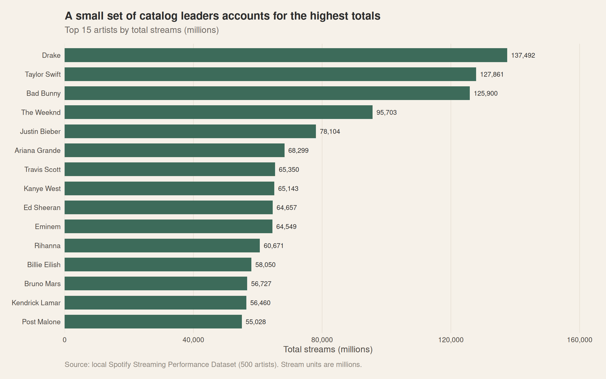
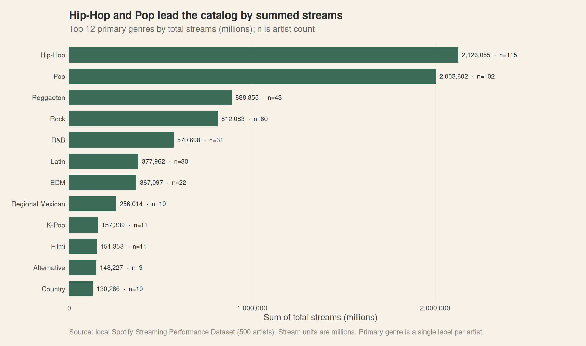
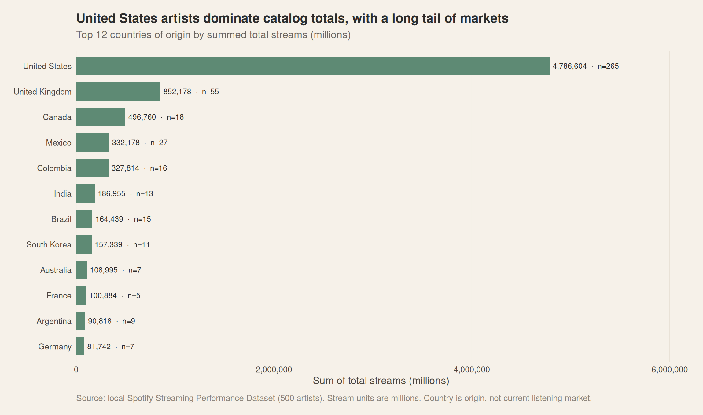
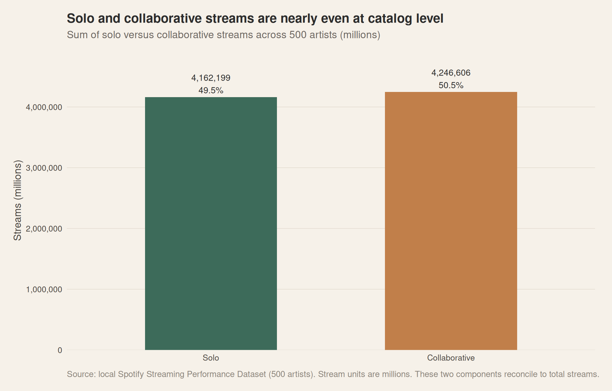
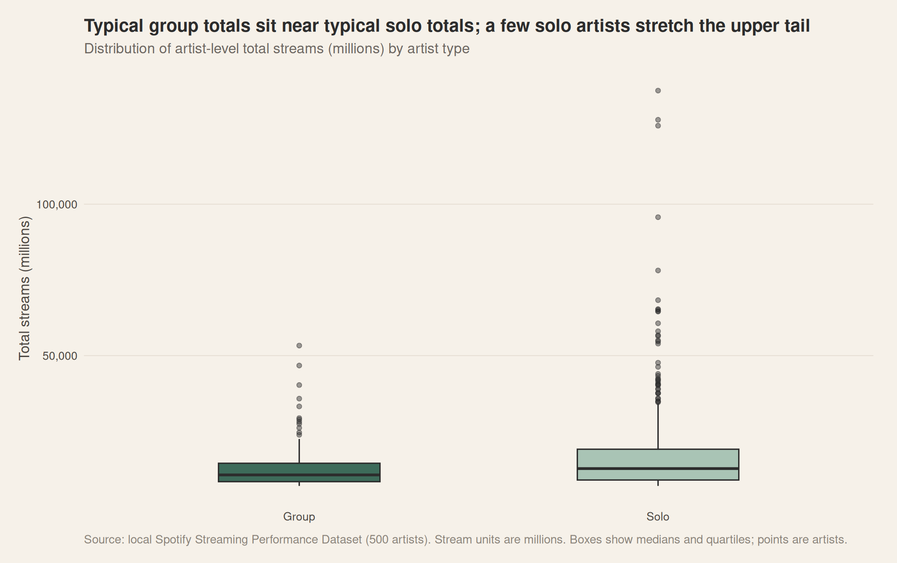
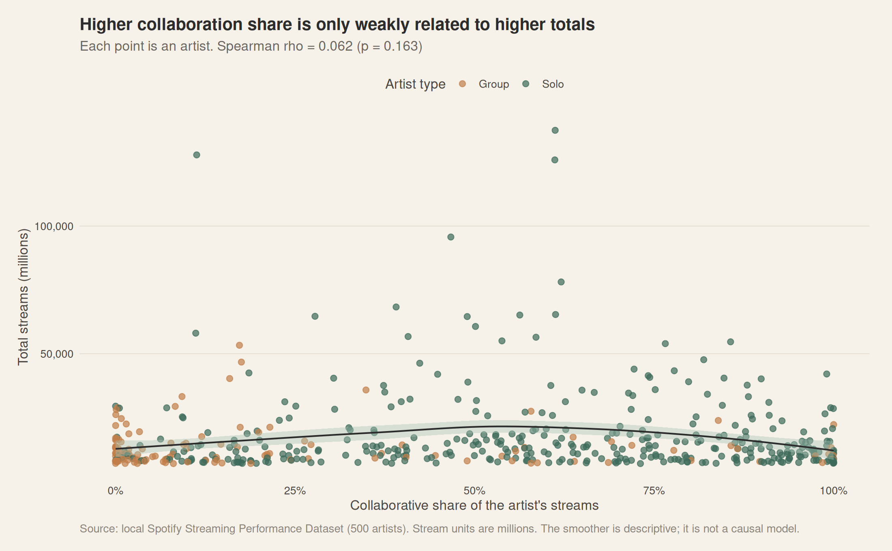
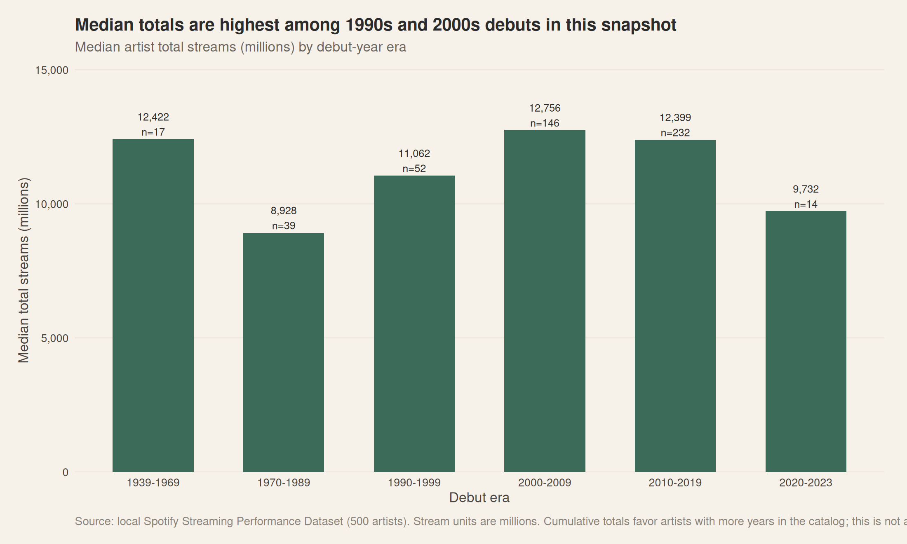
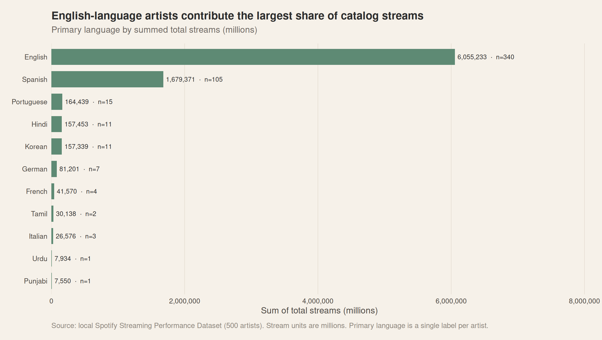
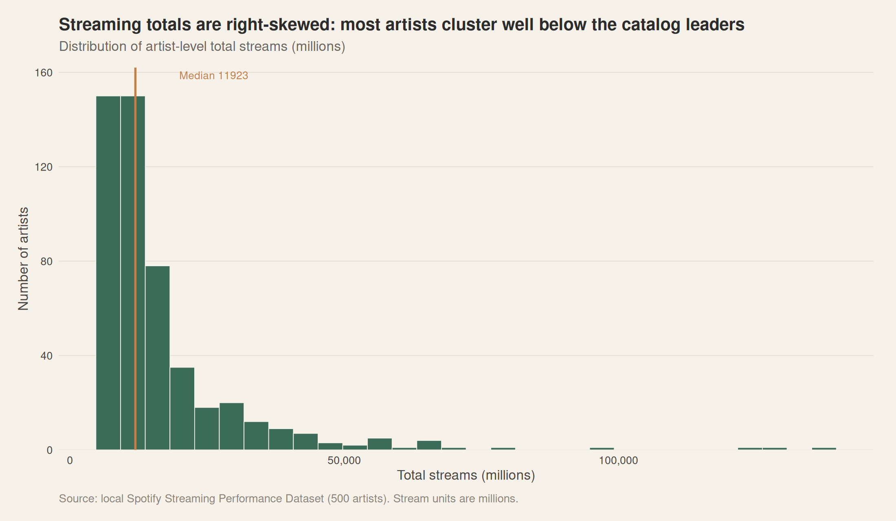
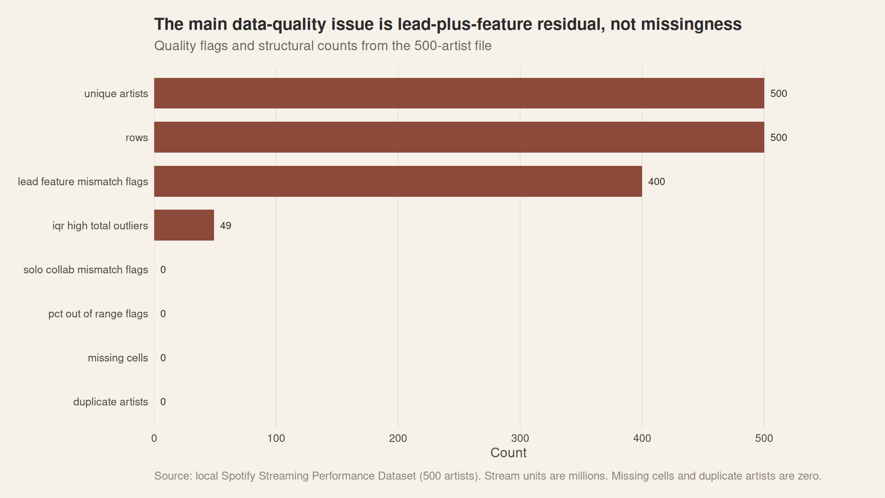

# Music Streaming Analytics — R & Power BI

An end-to-end music streaming analytics project built with **R, tidyverse, ggplot2, statistical analysis, and Power BI-ready datasets**. The project audits and cleans artist-level streaming data, engineers useful metrics, explores performance across artists and categories, generates reusable charts, and prepares data for an interactive Power BI report.

> **Important:** This repository contains R-generated analysis outputs and Power BI-ready data files. A `.pbix` or `.pbit` file was not present in the inspected project file listing. Do not describe the Power BI report as a completed `.pbix` until that file has actually been created and tested.

## Table of contents

- [Project goals](#project-goals)
- [Technology stack](#technology-stack)
- [Repository structure](#repository-structure)
- [Dataset and data quality](#dataset-and-data-quality)
- [Getting started on Ubuntu](#getting-started-on-ubuntu)
- [Run the analysis](#run-the-analysis)
- [Visualizations](#visualizations)
- [How to read the charts](#how-to-read-the-charts)
- [Power BI dashboard preparation](#power-bi-dashboard-preparation)
- [Reproducibility and validation](#reproducibility-and-validation)
- [Limitations](#limitations)
- [Future improvements](#future-improvements)

## Project goals

This project is designed to answer questions such as:

1. Which artists have the highest recorded total streams?
2. How are streams distributed across genres, countries, and languages?
3. How do solo and collaborative stream totals compare?
4. How does collaboration share relate to total streams?
5. How does streaming performance vary by artist type?
6. How do median streams differ across debut-year eras?
7. What does the overall distribution of total streams look like?
8. What data quality flags should be considered before interpreting the results?

These are analytical questions, not pre-established conclusions. Interpretations should be based on the current dataset and generated summary tables. Correlation does not establish causation.

## Technology stack

- **R** — data import, cleaning, feature engineering, statistical analysis, and reproducible reporting
- **tidyverse / readr / dplyr** — data manipulation and import
- **ggplot2 / scales** — visualization
- **CSV** — processed datasets and Power BI data exchange
- **Microsoft Power BI** — intended interactive dashboard layer
- **Git and GitHub** — version control and project presentation

Use the packages actually referenced by the scripts in this repository. The exact package list may vary with the implementation.

## Repository structure

The following is the expected structure based on the project artifacts. Some folders may contain additional files.

```text
Music-Streaming-Analytics/
├── data/
│   ├── raw/
│   │   └── Spotify Streaming Performance Dataset.csv
│   ├── processed/
│   │   ├── artists_cleaned.csv
│   │   ├── artists_features.csv
│   │   ├── powerbi_artists.csv
│   │   ├── powerbi_artist_type.csv
│   │   ├── powerbi_country.csv
│   │   ├── powerbi_debut_era.csv
│   │   ├── powerbi_genre.csv
│   │   ├── powerbi_kpis.csv
│   │   ├── powerbi_language.csv
│   │   └── powerbi_quality.csv
│   └── reference/
│       ├── column_mapping.csv
│       └── derived_metrics.csv
├── R/                         # R pipeline scripts
├── outputs/
│   ├── figures/               # PNG and PDF charts
│   ├── tables/                # analysis and audit tables
│   └── reports/               # generated reports, if present
├── powerbi/                   # Power BI-ready exports and documentation
├── tests/                     # validation tests and test fixtures
├── docs/                      # project documentation, if present
├── logs/                      # execution logs, if present
└── README.md
```

## Dataset and data quality

The raw input file used by the project is:

`data/raw/Spotify Streaming Performance Dataset.csv`

The available columns have included artist identity and categories, debut year, total streams, lead streams, feature streams, solo streams, collaborative streams, and percentage-share fields. **Always check the actual CSV header and the data dictionary in this repository before relying on a field name or definition.**

The project includes audit artifacts under `outputs/tables/`, including column profiles, categorical counts, numeric summaries, reconciliation results, outlier records, and quality summaries.

### Data handling principles

- Keep the original file in `data/raw/` unchanged.
- Inspect missing values, duplicate records, invalid ranges, and suspicious values before interpreting results.
- Confirm the grain of the dataset. Repeated artist rows may affect totals and averages.
- Do not sum percentage columns as if they were stream counts.
- Confirm units before comparing or combining stream metrics.
- Treat outliers as observations to investigate, not automatically as errors.
- Document exclusions, imputations, and transformations.
- Do not infer causation from correlations.

## Getting started on Ubuntu

### 1. Open the project directory

```bash
cd ~/Desktop/Music-Streaming-Analytics
```

### 2. Check the installed versions

```bash
R --version
git --version
```

If R is not installed, on Ubuntu you can install the distribution package:

```bash
sudo apt update
sudo apt install r-base
```

Some R packages may need system build dependencies. Install them only if an R package installation reports a specific missing dependency.

### 3. Inspect project files and scripts

```bash
find R -maxdepth 2 -type f -print | sort
find outputs/figures -maxdepth 1 -type f -print | sort
find outputs/tables -maxdepth 1 -type f -print | sort
```

### 4. Install the R packages required by the scripts

First inspect the scripts for their `library(...)` and `requireNamespace(...)` calls. Install the packages the project actually uses. For example, if these packages are referenced:

```r
install.packages(c("tidyverse", "janitor", "skimr", "scales"))
```

Do not install packages that the scripts do not need. If the repository uses `renv` and contains a valid lockfile, restore the recorded environment instead:

```r
install.packages("renv")
renv::restore()
```

Run `renv::restore()` only if the project is configured for `renv` and its lockfile is present.

## Run the analysis

The exact script names and execution order should be confirmed from the `R/` directory. List the scripts:

```bash
find R -maxdepth 1 -type f -name "*.R" -print | sort
```

If the project uses the numbered pipeline scripts, run them in their documented order. For example, **only if these files exist and are intended to run independently**, commands may look like:

```bash
Rscript R/01_data_audit.R
Rscript R/02_data_cleaning.R
Rscript R/03_feature_engineering.R
Rscript R/04_exploratory_analysis.R
Rscript R/05_statistical_analysis.R
Rscript R/06_visualizations.R
Rscript R/07_export_powerbi_data.R
```

If the project has a master runner script, prefer that documented entry point. Do not run guessed script names blindly: confirm them with `find R -maxdepth 1 -type f -name "*.R"` first.

After execution, inspect the outputs:

```bash
find data/processed outputs powerbi -type f -print | sort
```

### Open the charts

Open one chart:

```bash
xdg-open outputs/figures/01_top15_artists_total_streams.png
```

Open the figures folder in the file manager:

```bash
xdg-open outputs/figures/
```

If a filename or path differs, use the actual path returned by `find`.

## Visualizations

The following chart previews are generated as PNG files in `outputs/figures/`. Each preview is linked using a repository-relative path so it can display directly on GitHub after the file is committed.

### 1. Top 15 artists by total streams



**Purpose:** Compare the artists with the largest recorded total-stream values.

**How to read it:** Compare the bar lengths and the displayed stream units. Confirm whether each artist appears once or whether the analysis aggregates multiple rows per artist.

**Questions to investigate:** How concentrated are streams among the leading artists? How large is the gap between the highest-ranked artists and the rest?

**Related table:** `outputs/tables/top_artists.csv`

### 2. Total streams by genre



**Purpose:** Compare recorded stream totals across primary genres.

**How to read it:** Compare genre totals using the chart's axis and units. A total can be influenced by the number of artists represented in each genre.

**Interpretation caution:** A genre with a larger total does not necessarily have a higher average per artist. Consider artist counts and distribution before making performance claims.

**Related table:** `outputs/tables/genre_summary.csv`

### 3. Total streams by country



**Purpose:** Explore the distribution of recorded artist streams by country of origin.

**How to read it:** Compare country totals and check how the chart handles countries with few represented artists.

**Interpretation caution:** Country of origin is not necessarily the same as the location of listeners. Do not interpret this chart as listener geography unless the dataset directly measures listener location.

**Related table:** `outputs/tables/country_summary.csv`

### 4. Solo versus collaborative stream totals



**Purpose:** Compare the recorded totals for solo and collaborative streams.

**How to read it:** Check the units, definitions, and aggregation method used for each component.

**Interpretation caution:** Confirm whether solo and collaborative streams are mutually exclusive and whether their definitions reconcile with total streams. If they overlap, do not add them together as independent totals.

**Related table:** `outputs/tables/solo_collaborative_totals.csv`

### 5. Total streams by artist type



**Purpose:** Compare the distribution of artist streaming values across artist types.

**How to read it:** In a standard boxplot, the central line is the median, the box represents the interquartile range, and whiskers/outlier points follow the chart's implemented convention. Refer to the chart itself for its exact scales and labels.

**Why this chart matters:** A distribution view can reveal differences in typical performance and variability that are hidden by totals alone.

**Related table:** `outputs/tables/artist_type_summary.csv`

### 6. Collaboration share versus total streams



**Purpose:** Examine the relationship between collaboration share and total streams.

**How to read it:** Look for the overall direction, spread, clusters, and extreme observations. Check whether the horizontal and vertical axes use percentages, proportions, or stream units.

**Interpretation caution:** An observed association does not prove that collaboration causes higher or lower streaming performance. Outliers and the formula used for collaboration share can affect the pattern.

**Related tables:** `outputs/tables/spearman_correlation_matrix.csv` and `outputs/tables/statistical_tests.csv`

### 7. Median streams by debut era



**Purpose:** Compare the median recorded streams of artists grouped into debut-year eras.

**How to read it:** Compare medians across eras and consult the group sizes before drawing conclusions.

**Interpretation caution:** Newer and older eras may have different exposure periods or representation in the dataset. The chart alone cannot establish that debut era caused a difference in streams.

**Related table:** `outputs/tables/debut_era_summary.csv`

### 8. Total streams by language



**Purpose:** Compare recorded stream totals across the primary-language categories.

**How to read it:** Compare the plotted totals and check whether category counts vary substantially.

**Interpretation caution:** Primary language is not necessarily the language of every track or the language of the audience. Do not interpret the chart as a direct measure of listener language preference.

**Related table:** `outputs/tables/language_summary.csv`

### 9. Distribution of total streams



**Purpose:** Understand the spread and shape of artist-level total-stream values.

**How to read it:** Check the axes, bin widths, and whether the distribution is skewed or contains extreme values. A long tail may make the majority of observations appear compressed.

**Why this chart matters:** Distribution shape helps determine whether the mean, median, transformation, or robust summaries are more informative.

**Related tables:** `outputs/tables/audit_numeric_summary.csv` and `outputs/tables/numeric_distribution.csv`

### 10. Data quality flags



**Purpose:** Summarize data quality flags identified by the pipeline.

**How to read it:** Refer to the displayed categories and counts. A flag identifies a condition requiring review; it does not automatically prove that a record is wrong.

**Why this chart matters:** Data quality limitations affect how confidently the other charts can be interpreted.

**Related tables:** `outputs/tables/quality_summary.csv`, `outputs/tables/audit_column_profile.csv`, and `outputs/tables/audit_reconciliation.csv`

## How to read the charts

Before reporting any result:

1. Read the title and axis labels.
2. Confirm whether the metric is a sum, mean, median, count, share, or distribution.
3. Verify the units, especially if stream fields are recorded in millions.
4. Check the group size and whether categories have unequal representation.
5. Check for missing values, duplicate artist rows, and extreme observations.
6. Use the corresponding CSV summary table to confirm the values.
7. Describe association as association, not causation.
8. Report only findings that can be reproduced from the current data.

## Power BI dashboard preparation

The project includes Power BI-oriented CSV exports. Confirm the latest files exist before importing them.

Expected files include:

- `powerbi/powerbi_artists.csv`
- `powerbi/powerbi_artist_type.csv`
- `powerbi/powerbi_country.csv`
- `powerbi/powerbi_debut_era.csv`
- `powerbi/powerbi_genre.csv`
- `powerbi/powerbi_kpis.csv`
- `powerbi/powerbi_language.csv`
- `powerbi/powerbi_quality.csv`

Related exports may also exist in `data/processed/`.

### Suggested dashboard pages

1. **Executive Overview:** headline KPIs, leading artists, genre distribution, and key findings.
2. **Artist Performance:** artist rankings and stream-component comparisons.
3. **Genre and Market Analysis:** genre, country, and language comparisons.
4. **Collaboration Insights:** solo/collaborative metrics and collaboration share.
5. **Artist Lifecycle:** debut-era comparisons and group sizes.
6. **Data Quality and Methodology:** quality flags, definitions, and limitations.

### Create the report in Power BI Desktop

Power BI Desktop is not natively supported on Ubuntu. Use a compatible, authorized Windows environment to create the actual `.pbix` file.

1. Open Power BI Desktop.
2. Select **Get data → Text/CSV**.
3. Import the prepared CSV exports required for the report.
4. Review data types, numeric formats, and column names.
5. Create relationships only where the model and data grain justify them.
6. Add measures using the documented DAX definitions, if provided in `powerbi/measures.dax`.
7. Build the six pages using the dashboard specification.
8. Add slicers, tooltips, and cross-filtering where appropriate.
9. Validate totals against the corresponding R-generated summary tables.
10. Save the report as a `.pbix` file and reopen it to confirm it works.

Do not upload a `.pbix` claim or screenshot as a substitute for the actual report file. If a `.pbix` has not yet been created, describe Power BI as prepared/in progress rather than complete.

## Reproducibility and validation

Before publishing:

```bash
cd ~/Desktop/Music-Streaming-Analytics

# Confirm the raw input exists
test -f "data/raw/Spotify Streaming Performance Dataset.csv" \
  && echo "Raw dataset found"

# List analysis scripts
find R -maxdepth 1 -type f -name "*.R" -print | sort

# List charts
find outputs/figures -maxdepth 1 -type f \
  \( -iname "*.png" -o -iname "*.pdf" \) -print | sort

# List analysis tables
find outputs/tables -maxdepth 1 -type f -iname "*.csv" -print | sort

# Check repository changes before committing
git status --short
```

Run the actual project test command documented by the repository. If there is no automated test suite, add one and document what has and has not been tested. Never state that tests pass unless they have actually been executed.

## Limitations

- Findings are limited to the fields and records in the available dataset.
- Country of origin should not be confused with listener location.
- Associations do not establish causality.
- Aggregation results depend on the dataset grain and metric definitions.
- The availability and completeness of historical, genre, language, and collaboration fields may affect comparisons.
- A Power BI-ready dataset is not the same as a completed interactive Power BI report.
- Validate dataset provenance and redistribution permissions before publishing the raw CSV publicly.

## Future improvements

- Complete and validate the interactive Power BI `.pbix` report.
- Add automated data-quality and regression tests.
- Add a reproducible project environment using `renv`, if appropriate.
- Add a script that runs the complete pipeline from start to finish.
- Add an executive findings report with values calculated from the latest dataset.
- Add screenshots of the finished Power BI report after it has been built and verified.

## License and dataset attribution

Add a license only after deciding what license applies to your own code and checking the dataset's redistribution terms. Credit the original dataset provider using verified source details. Do not assume that the code license also grants permission to redistribute the raw data.
## 🚀 Running the Interactive Dashboard

The Music Streaming Analytics Dashboard is built using **Streamlit, Python, Pandas, and Plotly**. It provides interactive visualizations, KPI metrics, and filters to analyze music streaming performance.

### Prerequisites
- Python 3 installed
- Project dependencies installed

### Step 1: Navigate to the Project Directory

```bash
cd ~/Desktop/Music-Streaming-Analytics
```

### Step 2: Activate the Virtual Environment

```bash
source .venv/bin/activate
```

### Step 3: Install Dependencies

Run this command the first time, or whenever dependencies need to be installed:

```bash
python -m pip install -r requirements-dashboard.txt
```

### Step 4: Launch the Dashboard

```bash
python -m streamlit run app.py
```

### Step 5: Open the Dashboard

Open your browser and visit:

**http://localhost:8501**

The dashboard includes:
- **Key Performance Indicators (KPIs):** Total streams, number of artists, average streams, and median streams.
- **Top Artists Analysis:** Identify the top-performing artists by total streams.
- **Genre Analysis:** Compare streaming performance across music genres.
- **Country Analysis:** Explore streaming distribution by country.
- **Collaboration Analysis:** Compare solo and collaborative streaming performance.
- **Interactive Filters:** Filter data by genre, country, artist type, language, and debut year.
- **Data Export:** Download the filtered dataset as a CSV file.

### Stopping the Dashboard

Press `Ctrl + C` in the terminal to stop the dashboard.

### Note

This is an interactive web dashboard built with Streamlit and Plotly. It is not a native Microsoft Power BI `.pbix` file.
